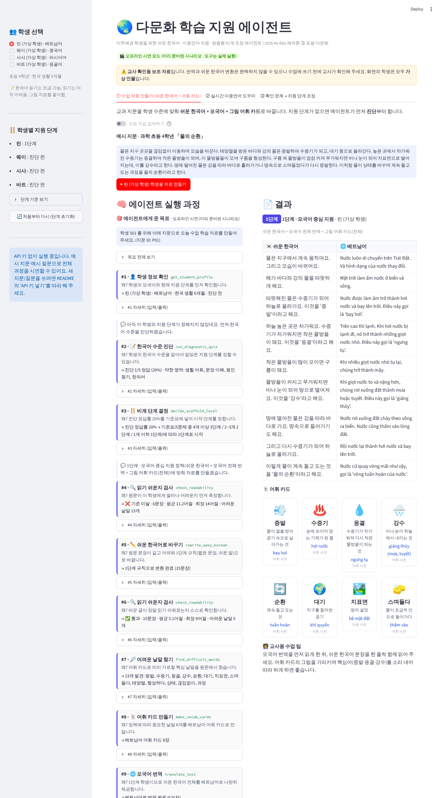
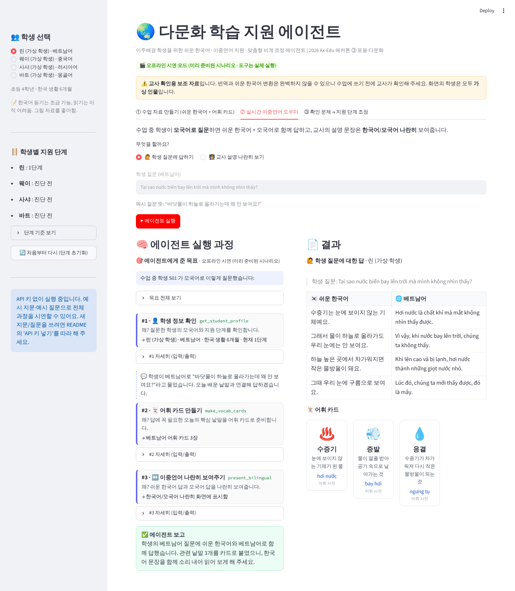
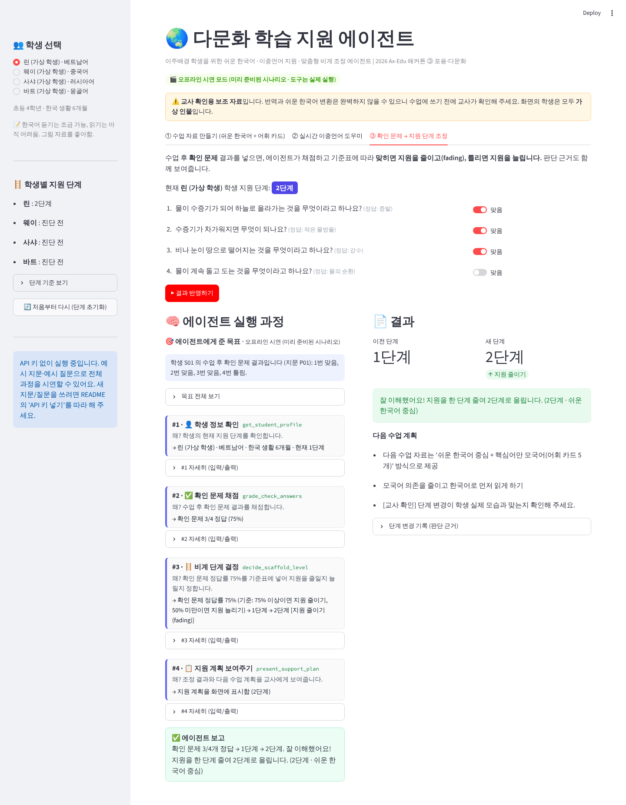

# 🌏 다문화 학습 지원 에이전트

> 2026 Ax-Edu 해커톤 · ③ 포용·다문화 에이전트

이주배경 학생(베트남어·중국어·러시아어·몽골어를 쓰고, 한국어는 초급~중급)이 수업을 따라올 수 있도록
**교사를 돕는 AI 에이전트**입니다. 교사가 "이 학생을 위해 오늘 수업 자료를 만들어 줘" 같은 **목표**를 주면,
에이전트는 어떤 도구를 어떤 순서로 쓸지 **스스로 정해서** 여러 단계를 거쳐 일을 끝냅니다.



---

## 1. 이 에이전트가 하는 일

| 기능 | 교실에서 생기는 일 | 에이전트가 하는 일 |
|---|---|---|
| ① 쉬운 한국어 + 시각 자료 | 교과서 문장이 길고 한자어가 많아 이해하지 못함 | 학생 수준에 맞게 **쉬운 한국어**로 바꾸고, 핵심 낱말을 **어휘 카드**(쉬운 뜻 + 그림 아이콘 + 모국어)로 만듦 |
| ② 실시간 이중언어 지원 | 학생이 모국어로 질문함 / 교사 설명을 놓침 | 질문에 **쉬운 한국어 + 모국어**로 함께 답하고, 교사 설명을 **한국어/모국어 나란히** 보여줌 |
| ③ 맞춤형 비계(scaffolding) | 학생마다 필요한 도움의 양이 다름 | **진단 문제**로 시작 단계를 정하고, 수업 후 **확인 문제** 결과로 지원을 줄이거나(fading) 늘림 |

> **비계(scaffolding)**: 학생이 혼자 하기 어려운 과제를 할 수 있도록 임시로 주는 도움. 학생이 성장하면 점점 줄여 갑니다(fading).

### 지원 단계 (비계)

| 단계 | 이름 | 학생에게 주는 자료 |
|---|---|---|
| 1단계 | 모국어 중심 지원 | 쉬운 한국어 + **모국어 전체 번역** + 어휘 카드 8장 |
| 2단계 | 쉬운 한국어 중심 | 쉬운 한국어 + **핵심어만 모국어**(어휘 카드 5장) |
| 3단계 | 원문 + 필요할 때만 도움 | **원문 한국어** + 어려운 낱말 괄호 풀이 + 어휘 카드 3장 |

- **시작 단계(진단 문제 5개)**: 4개 이상 맞히면 → 3단계 / 2~3개 → 2단계 / 1개 이하 → 1단계
- **수업 후(확인 문제 4개)**: 75% 이상 맞히면 지원 한 단계 줄이기 / 50% 미만이면 지원 한 단계 늘리기 / 그 사이는 유지

※ 위 기준은 시연용 초안이며, 현장 교사 의견을 받아 `agent/config.py` 의 숫자만 바꾸면 바로 반영됩니다.

---

## 2. 왜 '에이전트'인가 (단순 챗봇과의 차이)

단순 챗봇은 "질문 한 번 → 답 한 번"입니다. 이 에이전트는 **목표를 받아 스스로 계획하고, 도구를 골라 쓰고,
결과를 확인한 뒤 다음 행동을 바꿉니다.**

```
교사의 목표: "린 학생을 위해 '물의 순환' 지문으로 수업 자료를 만들어 줘"
   │
   ▼
[에이전트 = Claude]  ── 다음에 무엇을 할지 스스로 결정 ──┐
   │                                                     │
   ├─ 👤 학생 정보 확인     → "아직 진단 전이네"          │
   ├─ 📝 한국어 수준 진단   → "정답률 20%"               │  도구 결과를 보고
   ├─ 🪜 비계 단계 결정     → "기준표에 따라 1단계"        │  다음 행동을 바꿈
   ├─ 🔍 원문 읽기 난이도 검사 → "문장이 너무 김(평균 11어절)" │
   ├─ ✏️ 쉬운 한국어로 바꾸기                              │
   ├─ 🔍 다시 검사(스스로 확인) → "통과(평균 5어절)"         │
   ├─ 🔎 어려운 낱말 찾기 → 🃏 어휘 카드 만들기              │
   ├─ 🌐 모국어 번역 (1단계라서)                            │
   └─ 📄 학습 자료 화면에 보여주기 ◀──────────────────────┘
```

- 학생이 **3단계**였다면 에이전트는 번역을 **하지 않고** 원문에 괄호 풀이만 넣습니다. 학생에 따라 **사용하는 도구와 순서가 달라집니다.**
- 쉬운 한국어로 바꾼 글이 기준을 못 넘으면 **스스로 다시 고쳐 씁니다.**
- 화면 왼쪽에 **어떤 도구를, 왜, 어떤 결과로** 썼는지 단계별로 모두 보입니다(실행 과정 트레이스).

### 에이전트가 쓰는 도구 (12개)

| 도구 | 하는 일 |
|---|---|
| 👤 학생 정보 확인 | 모국어, 한국 생활 기간, 교사 메모, 현재 지원 단계 |
| 📝 한국어 수준 진단 | 진단 문제 결과(정답률, 약한 영역) |
| 🪜 비계 단계 결정 | 기준표로 단계를 정하고 판단 근거를 기록 (진단/확인 문제 모두) |
| 🔍 읽기 쉬운지 검사 | 문장 길이(어절 수)와 어려운 낱말을 세어 통과/미달 판정 |
| ✏️ 쉬운 한국어로 바꾸기 | 단계별 규칙에 맞춰 다시 쓰기 |
| 🔎 어려운 낱말 찾기 | 교과 핵심 어휘 사전에서 찾기 |
| 🃏 어휘 카드 만들기 | 쉬운 뜻 + 아이콘 + 모국어 (사전에 없으면 AI가 만들고 '교사 확인 필요' 표시) |
| 🌐 모국어 번역 | 줄 단위로 맞춰 번역 (나란히 보기용) |
| ✅ 확인 문제 채점 | 수업 후 확인 문제 정답률 계산 |
| 📄 / ↔️ / 📋 화면에 보여주기 | 학습 자료 / 이중언어 나란히 / 지원 계획 |

---

## 3. 시연 화면 사용법

처음 실행하면 **예시 지문(「물의 순환」, 새로 작성)** 과 **가상 학생 4명**이 이미 들어 있습니다.

1. 왼쪽에서 학생을 고릅니다. (린-베트남어 / 웨이-중국어 / 사샤-러시아어 / 바트-몽골어)
2. **① 수업 자료 만들기** 탭에서 빨간 버튼을 누르면, 왼쪽에 에이전트가 일하는 과정이, 오른쪽에 완성된 자료가 나옵니다.
   - 학생마다 진단 결과가 달라서 **1·2·3단계 자료가 각각 다르게** 만들어지는 것을 비교해 보세요.
3. **② 실시간 이중언어 도우미** 탭: 학생의 모국어 질문에 답하기 / 교사 설명 나란히 보기
4. **③ 확인 문제 → 지원 단계 조정** 탭: 맞음/틀림을 바꿔 가며 눌러 보면, 지원이 줄거나 늘어나고 그 **이유**가 기록됩니다.
5. 왼쪽 아래 **처음부터 다시** 버튼으로 초기화할 수 있습니다.

| 이중언어 도우미 | 지원 단계 조정 |
|---|---|
|  |  |

### 두 가지 실행 모드

| 모드 | 언제 | 무엇이 다른가 |
|---|---|---|
| 🎬 오프라인 시연 모드 | API 키가 **없을 때** (기본) | 도구(진단, 단계 결정, 가독성 검사, 어휘 사전, 채점)는 **실제로 실행**됩니다. AI가 글을 쓰고 도구를 고르는 부분만 **미리 준비된 시나리오**로 재생합니다. 예시 지문·예시 질문만 쓸 수 있습니다. |
| 🟢 실시간 AI 모드 | API 키를 **넣었을 때** | Claude 가 직접 도구를 고르고 글을 씁니다. **새 지문, 새 질문**도 쓸 수 있습니다. |

---

## 4. 실행 방법

### 가장 쉬운 방법 (내 컴퓨터)

1. [Python](https://www.python.org/downloads/) 을 설치합니다. (윈도우는 설치 첫 화면에서 **"Add python.exe to PATH"** 체크)
2. 이 저장소를 내려받습니다. (GitHub 화면의 초록색 **Code → Download ZIP** → 압축 풀기)
3. 폴더 안의 파일을 **더블클릭**합니다.
   - 윈도우: `run_windows.bat`
   - 맥: `run_mac.command` (처음에 막히면 마우스 오른쪽 클릭 → 열기)
4. 잠시 후 브라우저에 시연 화면이 열립니다. (처음 한 번은 설치 때문에 1~2분 걸립니다)

### API 키 넣기 (실시간 AI 모드를 쓰고 싶을 때)

1. [Claude 콘솔](https://console.anthropic.com/) 에서 API 키를 만듭니다.
2. 폴더 안의 `.env.example` 파일을 복사해서 이름을 `.env` 로 바꿉니다.
3. `.env` 파일을 메모장으로 열어 `ANTHROPIC_API_KEY=` 뒤에 키를 붙여 넣고 저장합니다.
4. 실행 파일을 다시 더블클릭하면 화면 위에 **🟢 실시간 AI 모드** 가 표시됩니다.

> `.env` 파일은 GitHub에 올라가지 않도록 설정되어 있습니다. 키를 다른 사람과 공유하지 마세요.

---

## 5. 안전·윤리

- **가상 학생만 사용**: 이름, 연락처 등 실제 학생 개인정보는 코드와 데이터 어디에도 없습니다.
- **교사 확인용 보조 자료**: 번역과 쉬운 한국어 변환은 완벽하지 않을 수 있어, 화면에 항상 안내 문구를 표시합니다.
  사전에 없는 낱말로 AI가 만든 어휘 카드에는 '교사 확인 필요' 표시가 붙습니다.
- **교육적 판단은 교사 기준대로**: 단계 결정은 AI 마음대로가 아니라 교사가 정한 기준표(`agent/config.py`)로만 이루어지고, 판단 근거가 기록됩니다.
- **저작권**: 예시 지문과 문제는 교과서를 베끼지 않고 새로 작성했습니다.
- **API 키 보호**: 키는 `.env` 파일로만 관리하고 저장소에 올리지 않습니다.

---

## 6. 폴더 구조 (개발 참고용)

```
app.py                  시연 화면 (Streamlit)
agent/
  runner.py             에이전트 루프 (Claude 가 도구를 고르고 → 실행 → 결과를 보고 다시 고름)
  tools.py              에이전트가 쓰는 도구 12개
  config.py             비계 단계·점수 기준 (교사 확인 후 숫자만 수정)
  offline_scripts.py    API 키 없을 때 쓰는 시연 시나리오
  llm.py                Claude API 연결
data/                   가상 학생, 예시 지문, 진단·확인 문제, 어휘 사전, 오프라인 시연 응답
tests/                  자동 점검 (python -m pytest tests)
```

기술 구성: Python · Claude API(tool use 기반 에이전트 루프, 모델 `claude-opus-5-5`) · Streamlit
